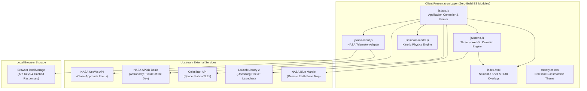

<div align="center">

# ECLIPTARA
### *Space Intelligence Observatory*

[](#-proprietary-notice--reservation-of-rights)
[](https://developer.mozilla.org/en-US/docs/Web/JavaScript)
[](https://threejs.org/)
[](https://api.nasa.gov/)
[](https://celestrak.org/)
[](tests/)
[](package.json)

<p align="center">
  <b>An evidence-first astronomical workspace and 3D celestial observatory for near-Earth object encounters, orbital asset tracking, and kinetic energy modeling.</b>
</p>

[Overview](#-1-project-overview) •
[Vision](#-2-product-purpose--vision) •
[Features](#-3-main-features) •
[Tech Stack](#-4-technology-stack) •
[Architecture](#-5-architecture-overview) •
[Interface](#-6-interface-preview) •
[Installation & Run](#-7-installation--running-locally) •
[Validation](#-10-testing--validation) •
[Legal Notice](#-15-proprietary-notice--reservation-of-rights)

---

</div>

## 🌌 1. Project Overview

**Ecliptara** is an independent, owner-maintained web observatory engineered for exploring near-Earth object (NEO) encounters and active orbital assets. The application combines a cinematic 3D Earth scene rendered via Three.js with source-verified close-approach data from NASA's Near Earth Object Web Service (NeoWs), multi-object comparative telemetry, live SGP4 satellite orbit propagation, an educational kinetic energy laboratory, and a daily spaceflight briefing.

The project is built on vanilla ECMAScript modules and modern CSS, requiring **zero bundlers or build steps**. It runs directly in contemporary browsers when served over standard HTTP.

> [!IMPORTANT]
> **Independent Project Notice:** Ecliptara is an independent, privately maintained project developed for educational and scientific exploration. It is not affiliated with, operated by, sponsored by, or endorsed by NASA, the Jet Propulsion Laboratory (JPL), CelesTrak, or any government agency.

---

## 🔭 2. Product Purpose & Vision

Modern reporting around asteroids frequently leans on sensationalist headlines, creating anxiety around routine astronomical close passes. Ecliptara is built on the founding principle of **Data Before Drama**:

- **Strict Physical Delineation:** Source-reported radar and optical measurements (nominal miss distance, relative velocity, absolute magnitude $H$) are kept visually distinct from estimated quantities (derived diameter ranges) and hypothetical scenarios.
- **Transparent Provenance:** Telemetry indicators explicitly flag whether data is `LIVE` (fresh upstream response), `CACHED` (offline browser fallback), `LOADING`, or `UNAVAILABLE`.
- **No Fabricated Risk Indices:** Ecliptara intentionally avoids inventing aggregate "danger scores" or artificial collision threat ratings.
- **Explicit Visualization Boundaries:** The 3D encounter field presents normalized schematic trajectories to provide spatial context without masquerading as millimetre-precision vector ephemerides.

---

## ✨ 3. Main Features

### 🌍 Photorealistic 3D Earth & Celestial Field
- Hardware-accelerated WebGL sphere using **Three.js (r164)**.
- High-resolution Earth surface map referencing **NASA Blue Marble: Next Generation**.
- Multi-layered atmospheric Rayleigh scattering rim shader, specular ocean highlights, and procedural cloud layer rotation.
- Starfield backdrop with axial tilt orientation.
- Interactive camera controls: orbit rotation, smooth zoom steps, and instant camera orientation reset (<kbd>R</kbd>).
- Interactive close-approach object markers with hover and selection indicators.

### ☄️ Real-Time NASA NeoWs Telemetry
- Direct programmatic integration with NASA's Near Earth Object Web Service.
- Date navigation across historical and upcoming UTC observation windows.
- Comprehensive object inspection files:
  - Designation, SPK-ID, and direct link to the NASA JPL Small-Body Database (SBDB).
  - Nominal miss distance displayed in Astronomical Units (AU), Kilometres (km), and Lunar Distances (LD).
  - Relative encounter velocity in $\text{km/s}$ and $\text{km/h}$.
  - Estimated diameter intervals (minimum and maximum bounds in metres).
  - Potentially Hazardous Asteroid (PHA) classification derived strictly from official IAU/NASA threshold criteria.
- Real-time filtering by PHA status, search by designation/name, and sorting by distance, velocity, diameter, or encounter timestamp.

### 📊 Multi-Encounter Comparative Analysis
- Side-by-side comparative workspace supporting up to three near-Earth objects concurrently.
- Normalized comparative bars across lunar distance, relative velocity, and estimated size.
- Pure observational comparison without arbitrary synthetic weighting.

### 🛰️ CelesTrak Orbital Asset Tracker
- Direct retrieval of Two-Line Element (TLE) sets from **CelesTrak's space stations group**.
- Real-time **SGP4 orbit propagation** via `satellite.js`.
- Derives instant geodetic latitude, longitude, altitude, and ground speed.
- Interactive equirectangular projection map plotting real-time sub-satellite points and track markers.
- Explicit display of TLE epoch age, orbital inclination, and period.

### 💥 Kinetic Energy Impact Laboratory
- An interactive, physics-grounded laboratory for exploring hypothetical kinetic impact dynamics.
- Implements classical mechanics equations:
  - Spherical volume: $V = \frac{\pi}{6} d^3$
  - Estimated mass: $m = \rho \cdot V$
  - Kinetic energy: $E_k = \frac{1}{2} m v^2$
- User-adjustable parameters: diameter ($1\text{ m}$ to $500\text{ m}$), velocity ($11\text{ km/s}$ to $72\text{ km/s}$), and bulk density models ($1,500\text{ kg/m}^3$, $3,000\text{ kg/m}^3$, $7,800\text{ kg/m}^3$).
- Formats energy output into Joules ($\text{J}$), Megatons of TNT ($1\text{ Mt} \approx 4.184 \times 10^{15}\text{ J}$), and 15-kiloton equivalent scales.
- Strictly accompanied by educational disclaimers regarding atmospheric entry, burst altitude, and target geology.

### 🔭 Spaceflight Operations & APOD Briefing
- **NASA Astronomy Picture of the Day (APOD)**: Daily high-resolution astronomical imagery with verified scientific explanations.
- **Launch Library 2 (The Space Devs)**: Live manifest of upcoming orbital rocket launches with live countdown timers and mission profiles.
- **System Integrity Monitor**: Live status indicator auditing API availability, network status, and cached states.

### ⚡ Command Palette & Ergonomics
- Universal command launcher via <kbd>Ctrl</kbd>+<kbd>K</kbd> / <kbd>Cmd</kbd>+<kbd>K</kbd>.
- Full keyboard navigation: <kbd>/</kbd> to search, <kbd>←</kbd>/<kbd>→</kbd> for UTC day shifts, <kbd>R</kbd> for camera reset, <kbd>Esc</kbd> to dismiss dialogs.
- Clean glassmorphism dark-mode interface with respect for `prefers-reduced-motion`.

---

## 🛠️ 4. Technology Stack

| Layer | Technologies & Dependencies | Purpose |
|:---|:---|:---|
| **Core Architecture** | HTML5 (Semantic), Vanilla ECMAScript 2024 (ES Modules) | Zero-build frontend structure |
| **Styling & UI** | CSS3 (Custom properties, CSS Grid, Flexbox, Glassmorphism) | Celestial dark-theme presentation |
| **3D Celestial Graphics** | [Three.js](https://threejs.org/) (r164 via jsDelivr CDN), OrbitControls | WebGL 3D globe and celestial scene |
| **Orbital Mechanics** | [satellite.js](https://github.com/shashwatak/satellite-js) (6.0.1 via jsDelivr CDN) | SGP4/SDP4 satellite orbit propagation |
| **Astronomical Feeds** | NASA NeoWs API, NASA APOD Basic API, CelesTrak API, Launch Library 2 API | Real-time space observation feeds |
| **Typography** | Space Grotesk, Manrope, DM Mono (Google Fonts CDN) | Scientific data typography |
| **Local Tooling** | Node.js (Built-in `http`, `fs`, `test`), Python (optional fallback) | Local static serving & test validation |

---

## 🏛️ 5. Architecture Overview



---

## 🖼️ 6. Interface Preview

```text
+---------------------------------------------------------------------------------------+
|  ✳ ECLIPTARA  |  CONNECTING TO OBSERVATION FEED  |  2026-10-30 UTC  |   [ ⌘ K ]  [EC] |
+-----------------------------------+-----------------------------------+---------------+
| 01 / ENCOUNTER INDEX              | THE CELESTIAL FIELD               | OBJECT FILE   |
| Near-Earth encounters.            | Earth, in context. [3D]           | (2024 YR4)    |
|                                   |                                   |               |
| [ ← ] [ 2026-10-30 ] [ → ]        |           .   *               .   | Miss Distance |
| [ Search designation... ]  [/]    |        .     .-----.              | 0.0028 AU     |
| [Sort: Closest approach v] [x] PHA|             /       \     *       | 1.09 LD       |
|                                   |            |  EARTH  |            |               |
| > 2024 YR4        0.0028 AU (1.09)|             \       /             | Velocity      |
|   2020 CD3        0.0142 AU (5.52)|              '-----'              | 14.2 km/s     |
|   99942 Apophis   0.0980 AU (38.1)|         \        .      /         |               |
|   2021 QM1        0.1205 AU (46.9)|          '--[x]--------'          | Est. Diameter |
|                                   |          NEO Trajectory           | 45 m - 100 m  |
+-----------------------------------+-----------------------------------+---------------+
| TIMELINE: [ | | | | | | | | | | | | | | | | | ] 2026-10-30 UTC       | SOURCE: LIVE  |
+---------------------------------------------------------------------------------------+
```

*(Note: Live graphical screenshots can be placed in `assets/screenshots/` for release showcases.)*

---

## 🚀 7. Installation & Running Locally

Ecliptara has **no compile step and no required npm package installations**. It runs using any standard HTTP server.

> [!CAUTION]
> Do not open `index.html` via `file://`. Browser security standards (CORS and ES Module import specifications) require HTTP/HTTPS serving.

### Prerequisites
- Any modern web browser (Chrome, Edge, Firefox, Safari) with WebGL support.
- **Node.js** (v18+ recommended) **OR** **Python** (3.8+).

---

## 🪟 8. Windows-Specific Setup Instructions

### Option A: One-Click Startup (Recommended)
Double-click [`start-windows.bat`](file:///c:/Users/kausi/Downloads/Ecliptara-Observatory/start-windows.bat) or run from PowerShell / Command Prompt:
```powershell
.\start-windows.bat
```
*The batch file automatically detects Node.js and starts the server via `node scripts/serve.js`. If Node.js is not present, it seamlessly falls back to Python.*

### Option B: Node.js Command Line
```powershell
# Using npm script:
npm run serve

# Or directly with Node:
node scripts/serve.js
```

### Option C: Python Command Line
```powershell
py -m http.server 4173
# Or:
python -m http.server 4173
```

---

## 🐧 9. macOS / Linux Setup Instructions

### Option A: One-Click Shell Script
```bash
chmod +x start-macos-linux.sh
./start-macos-linux.sh
```

### Option B: Node.js / npm
```bash
npm run serve
```

### Option C: Python 3
```bash
python3 -m http.server 4173
```

Once running, open your web browser to:
👉 **`http://localhost:4173`**

---

## 🧪 10. Testing & Validation

The repository includes a comprehensive zero-dependency verification pipeline covering JavaScript syntax, physics calculations, astronomical telemetry conversions, and DOM element mappings:

```powershell
# 1. Run physical model and telemetry unit tests:
npm test

# 2. Run DOM and asset reference validation:
npm run validate

# 3. Run complete verification suite (Syntax + Tests + DOM Validation):
npm run check
```

### Verification Pipeline Breakdown:
- **`node --check`**: Verifies valid syntax across `js/app.js`, `js/scene.js`, `js/neo-client.js`, and `js/impact-model.js`.
- **`node --test tests/*.test.js`**: Executes the Node.js test runner against:
  - Kinetic energy quadratic scaling ($E \propto v^2$).
  - Spherical volume and mass scaling ($m \propto d^3$).
  - Boundary input rejection (negative/zero diameter, velocity outside $11\text{--}72\text{ km/s}$).
  - Unit formatting for Joules, Megatons of TNT, and Hiroshima equivalents.
  - Astronomical distance conversions (AU to km, AU to LD).
  - Deterministic UTC date string formatting.
- **`scripts/validate_project.js`**: Verifies that every DOM element ID queried by `js/app.js` exists in `index.html`, identifies duplicates, and verifies all local file references.

---

## 🔑 11. API Integrations & Data Sources

| API / Resource | Provider | Endpoint / Usage | Default Key / Tier |
|:---|:---|:---|:---|
| **NeoWs Feed** | NASA / JPL | `https://api.nasa.gov/neo/rest/v1/feed` | Pre-configured with `DEMO_KEY` |
| **APOD Basic** | NASA Science | `https://science.nasa.gov/wp-json/wp/v2/apod-basic/` | Pre-configured with `DEMO_KEY` |
| **Stations TLE** | CelesTrak | `https://celestrak.org/NORAD/elements/gp.php` | Public open endpoint |
| **Launch Manifest** | The Space Devs | `https://ll.thespacedevs.com/2.2.0/launch/upcoming/` | Public tier (rate-limited) |
| **Earth Surface Map** | NASA Earth Obs. | `https://assets.science.nasa.gov/...` | Remote diffuse texture map |

---

## ⚙️ 12. Environment Configuration

Ecliptara operates with NASA's default `DEMO_KEY` out of the box. Because `DEMO_KEY` is shared globally and subject to rate limits (30 requests/hour, 50 requests/day per IP):

1. Request a personal API key from [api.nasa.gov](https://api.nasa.gov/).
2. In Ecliptara, click the **EC** settings button or press <kbd>Ctrl</kbd>+<kbd>K</kbd> and select **Preferences / Settings**.
3. Paste your personal key into the input field and click **Save preferences**.
4. The key is stored locally in your browser's private `localStorage` (`ecliptara:api-key`) and used exclusively for your requests.

*For server-side deployments or container environments, reference [`.env.example`](file:///.env.example) for template variable declarations.*

---

## ⚠️ 13. Known Limitations

1. **Schematic Encounter Paths:** NeoWs daily feeds provide close-approach scalars (miss distance, epoch time, relative velocity), not full vector ephemerides or state vectors. The 3D encounter paths rendered in Ecliptara are normalized schematic visualization aids, not numerical ephemeris integrators.
2. **Orbital Asset Scope:** The satellite view loads CelesTrak's `stations` group (active space stations). It does not include the complete 25,000+ object NORAD catalog or operational debris tracking.
3. **Hypothetical Impact Model:** The impact laboratory models an idealized spherical body impacting at constant velocity. It does not model atmospheric ablation, airburst altitudes, fragmentation mechanics, seismic coupling, or geographic damage footprints.
4. **Third-Party Availability:** Live telemetry depends on the operational availability and network response times of upstream providers (NASA, CelesTrak, The Space Devs).

---

## ⌨️ 14. Keyboard Shortcuts

| Shortcut | Context | Action |
|:---:|:---:|:---|
| <kbd>Ctrl</kbd> + <kbd>K</kbd> / <kbd>⌘</kbd> + <kbd>K</kbd> | Global | Open the Ecliptara Command Palette |
| <kbd>/</kbd> | Global | Focus the encounter search bar |
| <kbd>←</kbd> | Global | Step observation window back 1 UTC day |
| <kbd>→</kbd> | Global | Step observation window forward 1 UTC day |
| <kbd>R</kbd> | 3D Scene | Reset camera orientation and zoom |
| <kbd>Esc</kbd> | Modals / Views | Dismiss open dialogs or clear selected object file |

---

## 📜 15. Proprietary Notice & Reservation of Rights

**Copyright © 2026 Ecliptara Project Owner. All rights reserved.**

**No open-source license is granted for this repository. Viewing the publicly accessible repository does not grant permission to copy, modify, distribute, or commercially use the original project code.**

This repository is made publicly visible on GitHub exclusively for evaluation, scientific exploration, and portfolio review. Except where permitted under applicable statutory copyright law (such as fair use or fair dealing):
- No permission is granted to reproduce, fork for redistribution, sublicense, sell, or create derivative works of original Ecliptara source code, styles, or visual brand assets.
- Third-party software libraries ([Three.js](https://threejs.org/), [satellite.js](https://github.com/shashwatak/satellite-js)), public datasets ([NASA NeoWs](https://api.nasa.gov/), [CelesTrak](https://celestrak.org/), [Launch Library 2](https://thespacedevs.com/llapi)), remote imagery ([NASA Blue Marble](https://science.nasa.gov/earth/earth-observatory/blue-marble-next-generation/base-map/)), and typography remain governed by their respective licenses and terms of use.

For detailed third-party licensing, attributions, and legal notices, consult [`CREDITS.md`](CREDITS.md).

---

<div align="center">
  <sub>Engineered with precision for space exploration enthusiasts and astronomical researchers.</sub><br>
  <b>Ecliptara — Data Before Drama.</b>
</div>
