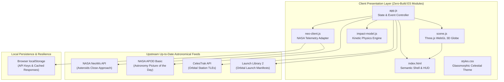

<div align="center">

# 🌐 ECLIPTARA
### Space Intelligence Observatory & Near-Earth Encounter Telemetry

[](LICENSE)
[](https://developer.mozilla.org/en-US/docs/Web/JavaScript)
[](https://threejs.org/)
[](https://api.nasa.gov/)
[](https://celestrak.org/)
[](tests/)
[](package.json)

<p align="center">
  <b>An evidence-first astronomical telemetry workspace and 3D celestial observatory for near-Earth object (NEO) close encounters, orbital asset tracking, and kinetic impact energy modeling.</b>
</p>

[Explore Capabilities](#-core-capabilities) •
[Architecture](#-system-architecture) •
[Scientific Guardrails](#-scientific-methodology--guardrails) •
[Quickstart](#-quick-start) •
[API Configuration](#-api-configuration) •
[Documentation](#-keyboard-shortcuts)

---

</div>

## 🌌 Overview

**Ecliptara** is an independent, high-fidelity web observatory engineered for exploring near-Earth object (NEO) encounters and active orbital assets. It combines a cinematic WebGL 3D Earth field with source-verified close-approach data from NASA's Jet Propulsion Laboratory (JPL) NeoWs, side-by-side multi-parameter encounter comparisons, an educational kinetic energy laboratory, live SGP4 satellite propagation, and a daily spaceflight briefing.

```
       .               +   .                .   . .     .  .
   .                    .       .               .         .   .
           .      _______________________     .          .
     .           /                       \          .
         .      /     E C L I P T A R A   \    .           .
               |     [ 3D CELESTIAL FIELD ] |        .       +
    +          \      EARTH - NEO - ASSETS /    .
          .     \_______________________/            .
     .           .            |             .            .
                      DATA BEFORE DRAMA
```

> [!IMPORTANT]
> **Independent Scientific Instrument:** Ecliptara is an independent educational and research exploration tool. It is not affiliated with, operated by, or endorsed by NASA, the Jet Propulsion Laboratory (JPL), or any government agency.

---

## 🧭 Core Philosophy: Data Before Drama

Modern media frequently mischaracterizes near-Earth asteroids using fear-inducing headlines and unsupported "apocalypse scores." Ecliptara rejects sensationalism through strict adherence to scientific provenance:

1. **Observed vs. Inferred:** Source-reported radar and optical measurements (e.g. miss distance, relative velocity, absolute magnitude $H$) are kept distinct from derived quantities (estimated diameter ranges).
2. **Transparent Confidence & Provenance:** Every displayed record explicitly flags its state: `LIVE` (verified upstream response), `CACHED` (offline/fallback local storage), `LOADING`, or `UNAVAILABLE`.
3. **No Fabricated Risk Indices:** Ecliptara intentionally avoids aggregating multi-dimensional orbital parameters into an arbitrary single "Earth danger score."
4. **Schematic Integrity:** The 3D encounter field transparently presents normalized schematic trajectories for visual context rather than claiming millimetre-precision vector ephemerides.

---

## ✨ Core Capabilities

### 🌍 1. Photorealistic 3D Earth & Celestial Field
- Powered by **Three.js (r164)** with hardware-accelerated WebGL rendering.
- High-resolution Earth base mapping from **NASA Blue Marble: Next Generation**.
- Multi-layered atmospheric Rayleigh scattering rim shader, specular ocean reflections, and procedural rotational cloud deck.
- Dynamic deep-space starfield with authentic celestial axial tilt and orbital plane orientation.
- Intuitive orbit navigation with smooth damping, custom zoom steps, and instant camera frame reset.
- Schematic close-approach trajectory guides with interactive asteroid hitboxes and contextual focus telemetry.

### ☄️ 2. Real-Time NASA NeoWs Near-Earth Intelligence
- Live programmatic interface to **NASA's Near Earth Object Web Service (NeoWs)**.
- Query any historical or future UTC observation date with single-click navigation.
- Deep encounter inspect files:
  - **Designation & SPK-ID** with direct link to NASA JPL Small-Body Database (SBDB).
  - **Nominal & Minimum Miss Distance** reported simultaneously in Astronomical Units (AU), Kilometres (km), and Lunar Distances (LD).
  - **Relative Velocity** in $\text{km/s}$ and $\text{km/h}$.
  - **Estimated Diameter Bounds** (minimum to maximum spans calculated from optical absolute magnitude $H$ and albedo models).
  - **Potentially Hazardous Asteroid (PHA)** classification derived strictly from official astronomical criteria.
- Real-time catalog filtering: filter by PHA status, search by designation/name, or sort by closest approach, peak velocity, largest diameter, or approach time.

### 📊 3. Multi-Asteroid Comparative Telemetry
- Compare up to three near-Earth objects side-by-side in a dedicated analysis workspace.
- Multi-parameter normalized telemetry bars:
  - Lunar Distance comparisons ($1 \text{ LD} \approx 384,400 \text{ km}$).
  - Hyperbolic encounter velocity deltas.
  - Volumetric and diameter spread ranges.
- Zero synthetic scoring: evaluations are based purely on physical observations.

### 🛰️ 4. CelesTrak Orbital Asset & Constellation Tracker
- Direct integration with **CelesTrak's space stations catalog**.
- Real-time **SGP4 orbital propagation** using `satellite.js`.
- Derives instant sub-satellite geodetic coordinates (Latitude, Longitude, Altitude) and velocity.
- Plots real-time ground tracks and current vehicle positions on an equirectangular orbital map.
- Displays orbital parameters: TLE epoch age, orbital inclination, period, and altitude above sea level.

### 💥 5. Kinetic Energy & Impact Physics Laboratory
- An interactive, physics-grounded laboratory for exploring hypothetical kinetic impact dynamics.
- Implements classical kinetic energy physics:
  $$\text{Volume: } V = \frac{4}{3}\pi \left(\frac{d}{2}\right)^3 = \frac{\pi d^3}{6}$$
  $$\text{Mass: } m = \rho \cdot V$$
  $$\text{Kinetic Energy: } E_k = \frac{1}{2} m v^2$$
- Custom user-configurable parameters:
  - Asteroid diameter: $1\text{ m}$ to $500\text{ m}$.
  - Atmospheric entry velocity: $11\text{ km/s}$ (Earth escape velocity baseline) to $72\text{ km/s}$ (retrograde solar system maximum).
  - Bulk density models: Porous carbonaceous body ($1,500\text{ kg/m}^3$), Rocky silicate body ($3,000\text{ kg/m}^3$), Iron-nickel body ($7,800\text{ kg/m}^3$).
- Formats energy output into Joules ($\text{J}$), Megatons of TNT ($1\text{ Mt} \approx 4.184 \times 10^{15}\text{ J}$), and standard 15-kiloton equivalent scales.
- Enforces strict educational disclaimers regarding atmospheric ablation, burst altitude, and seismic coupling.

### 🔭 6. Spaceflight Operations & APOD Briefing
- **NASA Astronomy Picture of the Day (APOD)**: Daily high-resolution imagery and professional astronomical breakdown.
- **Launch Library 2 (The Space Devs)**: Live manifests of upcoming orbital rocket launches, launch providers, mission profiles, and synchronized countdown timers.
- **System Integrity Feed**: Live status indicator monitoring API health, network availability, and cache synchronization.

### ⚡ 7. Command Palette & Ergonomics
- Universal command launcher via <kbd>Ctrl</kbd>+<kbd>K</kbd> / <kbd>Cmd</kbd>+<kbd>K</kbd>.
- Instant search across all loaded asteroids, navigation between observatory views, and camera orientation reset.
- Native keyboard accessibility: <kbd>/</kbd> to search, <kbd>←</kbd>/<kbd>→</kbd> for UTC day shifts, <kbd>R</kbd> for camera reset, <kbd>Esc</kbd> to clear selections or dismiss modals.
- Glassmorphism dark-mode interface with respect for `prefers-reduced-motion`.

---

## 🏗️ System Architecture



---

## 🔬 Scientific Methodology & Guardrails

### 1. Potentially Hazardous Asteroid (PHA) Definition
In international astronomical convention (NASA JPL / IAU Minor Planet Center), an asteroid is classified as a **Potentially Hazardous Asteroid** if and only if:
1. Its **Minimum Orbit Intersection Distance (MOID)** with Earth is $\le 0.05\text{ AU}$ (approx. $7,480,000\text{ km}$ or $19.5\text{ LD}$).
2. Its **Absolute Magnitude ($H$)** is $\le 22.0$, corresponding approximately to a diameter larger than $140\text{ metres}$ assuming an albedo of $0.14$.

A classification of PHA does **not** mean an impact will occur; it simply categorizes the object as an astronomical body whose orbit warrants long-term tracking.

### 2. Lunar Distance (LD) Scale
Measurements in deep space are difficult to grasp in raw kilometres. Ecliptara uses Lunar Distance as a primary comparative unit:
$$1\text{ LD} = 384,400\text{ km} \approx 0.00257\text{ AU}$$
An object passing at $5\text{ LD}$ is nearly 2 million kilometres away—well outside any physical threat to Earth or low-Earth orbit satellites.

### 3. Kinetic Energy Equation
The impact laboratory computes kinetic energy using classical non-relativistic mechanics:
$$E_k = \frac{1}{2} m v^2$$
For a spherical body of diameter $d$ and bulk density $\rho$:
$$m = \frac{\pi}{6} \rho d^3$$
$$E_k = \frac{\pi}{12} \rho d^3 v^2$$
The energy is converted to TNT equivalent using the standard convention:
$$1\text{ Megaton TNT (Mt)} = 4.184 \times 10^{15}\text{ Joules}$$

---

## ⌨️ Keyboard Shortcuts

| Shortcut | Context | Action |
|:---:|:---:|:---|
| <kbd>Ctrl</kbd> + <kbd>K</kbd> / <kbd>⌘</kbd> + <kbd>K</kbd> | Global | Open the Ecliptara Command Palette |
| <kbd>/</kbd> | Global | Focus the encounter search input |
| <kbd>←</kbd> | Global | Step observation window back 1 UTC day |
| <kbd>→</kbd> | Global | Step observation window forward 1 UTC day |
| <kbd>R</kbd> | 3D Scene | Reset camera orientation and zoom |
| <kbd>Esc</kbd> | Modals / Workspace | Dismiss open dialogs or clear selected object file |

---

## 🚀 Quick Start

Ecliptara is built with vanilla ECMAScript modules and requires **zero build steps, bundlers, or package installations**. It runs directly in modern browsers when served over HTTP.

> [!WARNING]
> Do not open `index.html` using a `file://` protocol. Modern ES module imports and fetch policies require an HTTP server environment.

### Option 1: Native Startup Scripts

**Windows:**
Double-click `start-windows.bat` or run:
```powershell
.\start-windows.bat
```

**macOS / Linux:**
Run the shell script:
```bash
chmod +x start-macos-linux.sh
./start-macos-linux.sh
```

### Option 2: Python Built-in Server

```bash
# Windows
py -m http.server 4173

# macOS / Linux
python3 -m http.server 4173
```

### Option 3: Node.js / npx

```bash
npx serve -l 4173 .
```

Once running, navigate your browser to:
👉 **[http://localhost:4173](http://localhost:4173)**

---

## 🔑 API Configuration

Ecliptara is pre-configured with NASA's default `DEMO_KEY`, enabling immediate exploration. However, NASA's shared demo key is subject to strict hourly rate limits (30 requests per IP per hour, 50 per day).

To use your personal free key:
1. Obtain an API key instantly from [api.nasa.gov](https://api.nasa.gov/).
2. Click the **EC** preferences avatar or open the Command Palette (<kbd>Ctrl</kbd>+<kbd>K</kbd>) and select **Preferences / Settings**.
3. Paste your personal API key into the NASA API key field and click **Save preferences**.
4. Your key is stored securely in your browser's private `localStorage` and never transmitted to third-party servers.

---

## 📁 Repository Structure

```text
Ecliptara-Observatory/
├── assets/
│   └── mark.svg                   # Brand mark and vector observatory insignia
├── css/
│   └── styles.css                 # Glassmorphism UI, celestial layout, and responsive styles
├── js/
│   ├── app.js                     # Application lifecycle, views, commands, and telemetry
│   ├── impact-model.js            # Kinetic impact laboratory physics calculations
│   ├── neo-client.js              # NASA NeoWs API client, caching, and formatting
│   └── scene.js                   # Three.js WebGL Earth and encounter visualization
├── scripts/
│   ├── validate_project.js        # Node.js project integrity and DOM reference validator
│   └── validate_project.py        # Python project integrity and HTML parser validator
├── tests/
│   ├── impact-model.test.js       # Unit tests for kinetic impact calculations
│   └── neo-client.test.js         # Unit tests for NeoWs telemetry, conversions, and units
├── .gitignore                     # Git ignore rules for node, cache, and system files
├── CHANGELOG.md                   # Chronological version history and release notes
├── CREDITS.md                     # Upstream dataset credits and asset licenses
├── index.html                     # Semantic observatory markup and layout structure
├── LICENSE                        # MIT Open Source License
├── package.json                   # Project metadata, test runner, and check scripts
├── README.md                      # Comprehensive observatory documentation and field guide
├── start-macos-linux.sh           # One-click startup script for UNIX systems
└── start-windows.bat              # One-click startup script for Windows systems
```

---

## 🧪 Testing & Validation

Ecliptara includes an automated test and verification suite ensuring code correctness, physical calculation accuracy, and DOM integrity:

```bash
# Run unit tests
npm test

# Run DOM and asset validation
npm run validate

# Run complete check (syntax + unit tests + project validation)
npm run check
```

### Verification Pipeline:
- **`node --check`**: Verifies valid ECMAScript syntax across all core modules.
- **`node --test tests/*.test.js`**: Validates kinetic energy formulas, volume scaling, boundary conditions, astronomical distance conversions, and deterministic UTC date formatting.
- **`scripts/validate_project.js`**: Validates that all HTML IDs referenced in JavaScript exist, identifies duplicates, and verifies local asset links.

---

## 🗺️ Roadmap

- [x] Three.js photorealistic Earth with Rayleigh atmospheric scattering.
- [x] NASA NeoWs live close-approach telemetry integration.
- [x] Multi-object comparative telemetry workspace.
- [x] CelesTrak SGP4 satellite propagation & sub-satellite map.
- [x] Kinetic impact laboratory with density and velocity models.
- [x] NASA APOD & Launch Library 2 spaceflight briefings.
- [x] Command Palette (<kbd>Ctrl</kbd>+<kbd>K</kbd>) & keyboard ergonomics.
- [ ] Integration with JPL Sentry Risk Table for automated impact risk monitoring.
- [ ] SPICE kernel ephemeris integration for sub-kilometre trajectory plotting.
- [ ] Custom WebGL shader for real-time solar terminator and day/night shadow cycles.
- [ ] Expanded satellite tracking to Starlink and OneWeb low-Earth constellations.

---

## 📄 License & Attribution

This project is licensed under the **MIT License** — see the [LICENSE](LICENSE) file for full details.

### Third-Party Data & Asset Credits
- **NASA Near Earth Object Web Service (NeoWs)**: Data courtesy of NASA / JPL Small-Body Database ([api.nasa.gov](https://api.nasa.gov/)).
- **NASA Blue Marble Imagery**: Earth base texture courtesy of NASA Science Earth Observatory ([Blue Marble Collection](https://science.nasa.gov/earth/earth-observatory/blue-marble-next-generation/base-map/)).
- **NASA APOD**: Astronomy Picture of the Day service operated by NASA Science.
- **CelesTrak**: Satellite orbital two-line element sets (TLEs) courtesy of Dr. T.S. Kelso / [CelesTrak](https://celestrak.org/).
- **Launch Library 2**: Spaceflight schedules provided by [The Space Devs](https://thespacedevs.com/llapi).
- **Three.js**: 3D graphics library created by [Ricardo Cabello (mrdoob)](https://threejs.org/).

See [`CREDITS.md`](CREDITS.md) for detailed upstream licensing and usage conditions.

---

<div align="center">
  <sub>Engineered with precision for space exploration enthusiasts and astronomical researchers.</sub><br>
  <b>Ecliptara — Data Before Drama.</b>
</div>
